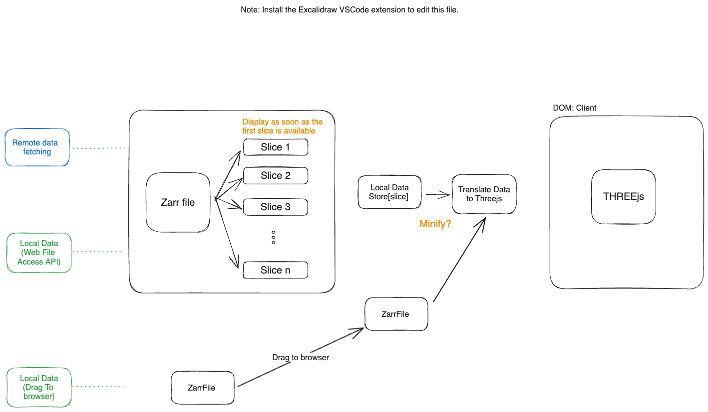

# Ruisdael on Display

[](https://opensource.org/licenses/Apache-2.0)
[](https://research-software-directory.org/software/zarrvis)

Ruisdael Visualizer

# Documentation for developers

```bash
# install with
$ npm install

# Run with
$ npm run dev
```

Place the [ql.zarr] data file indisde the `/public/data` folder

## Ground view

Drag **Ground view** onto the map, or select it and click a map location, to look up at the cloud
volume from the surface. Drag in the viewer to look around and select **Return to map** to restore
the previous view. The sun follows the time-of-day control.

Ground view uses Mapzen Terrain Tiles (bare-earth elevation) with the existing Sentinel-2 cloudless
imagery, not Google imagery or 3D buildings. It needs network access to the terrain and imagery tile
services. Elevation is approximate, and the map is aligned to the viewer's fixed Netherlands domain.
Terrain attribution and data sources are linked in the viewer.

## Technical Stack



Running on custom VPS.
